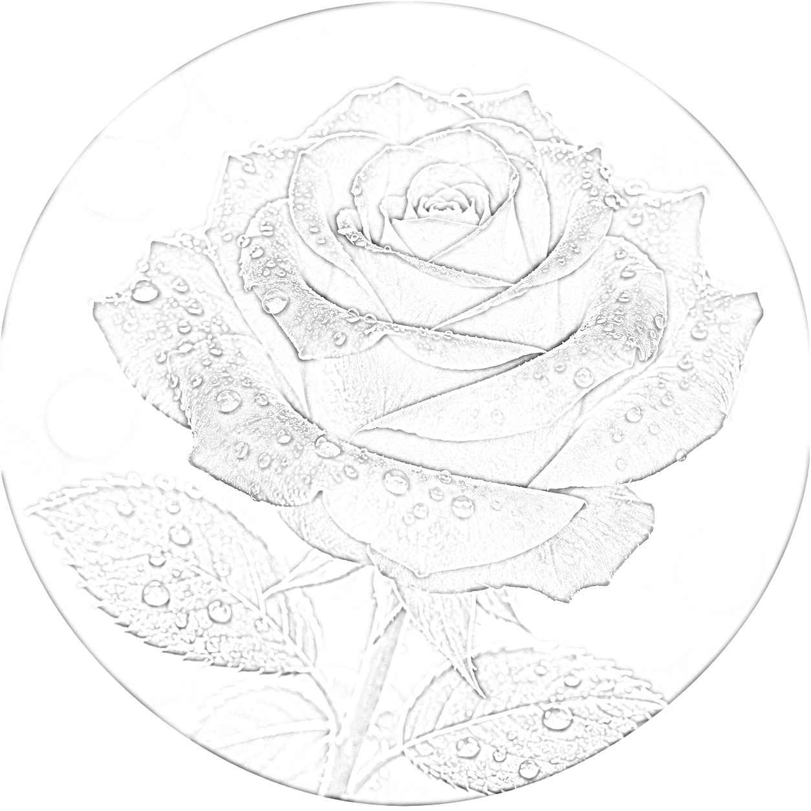

# 🎨 Image to Art Converter (OpenCV & Streamlit)

تطبيق متكامل يحول الصور ومقاطع الفيديو إلى أعمال فنية (رسم بالقلم الرصاص، تأثير كرتوني، وعزل الخلفية) باستخدام **OpenCV** و **Python**. يعمل التطبيق عبر واجهة سطر أوامر (CLI) وكاميرا مباشرة، بالإضافة إلى واجهة ويب تفاعلية متقدمة باستخدام **Streamlit**.


---

## 📸 صور من المشروع (قبل وبعد)

| الصورة الأصلية (Before) | النتيجة (After) |
| :---: | :---: |
|  |  |

---

## ✨ المميزات (Features)

- **🖼️ تحويل الصور:** تحويل أي صورة إلى رسم رصاص (Sketch) أو تأثير كرتوني (Cartoon).
- **🎥 الفيديو المباشر:** تشغيل الكاميرا مع إمكانية التبديل الفوري بين الفلاتر بنقرة زر.
- **🎚️ شرائط تحكم (Trackbars):** التحكم في نعومة الألوان وحدة الحواف أثناء عرض الفيديو مباشرة.
- **🧑‍🤝‍🧑 عزل الخلفية (Background Removal):** تحويل الخلفية إلى الأبيض والأسود مع الحفاظ على ألوان الشخص (باستخدام MediaPipe).
- **🌐 واجهة ويب متقدمة:** واجهة تفاعلية عبر Streamlit تدعم التبويبات، وشرائط التمرير، وسجل العمليات (History).

---

## 🚀 خطوات التثبيت والتشغيل (Installation & Usage)

اتبع هذه الخطوات بالترتيب لتشغيل المشروع على جهازك.

### 1. تجهيز البيئة (Setup)
أولاً، قم بتنزيل الكود (Clone) وإنشاء بيئة افتراضية:
```bash
# استنساخ المستودع (غير YOUR_USERNAME إلى اسم حسابك)
git clone https://github.com/YOUR_USERNAME/image-to-art.git
cd image-to-art

# إنشاء بيئة افتراضية
python -m venv .venv

# تفعيل البيئة (في ويندوز):
.venv\Scripts\activate
# (في ماك أو لينكس:)
source .venv/bin/activate